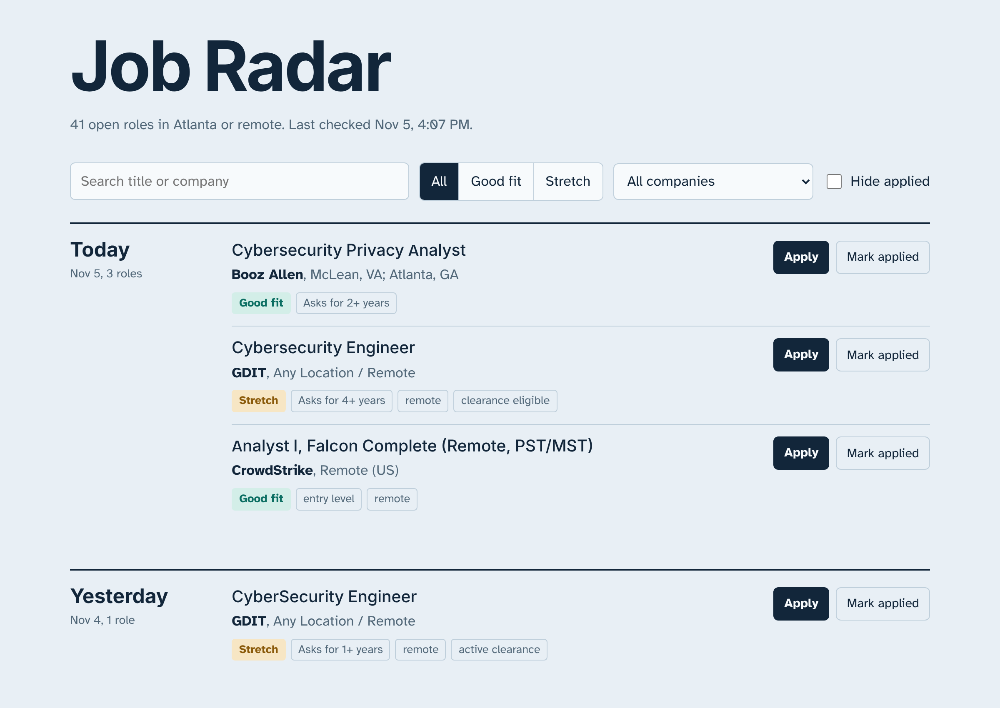
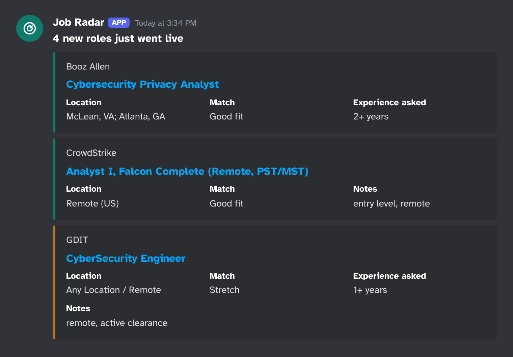
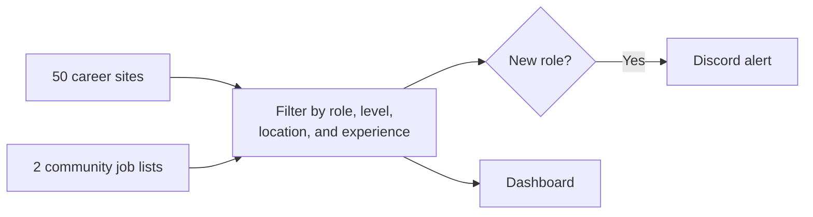

<div align="center">

# 📡 Job Radar

**Get a Discord alert when an entry-level cybersecurity job goes live in Atlanta.**

Job Radar watches employer career sites directly, filters out roles you can't realistically apply to, and keeps every open match on one dashboard.

[](https://github.com/eristenn/job-radar/actions/workflows/radar.yml)


**[Open the live dashboard](https://eristenn.github.io/job-radar/)** | [Set up your own](#set-up-your-own) | [Change what it watches](#change-what-it-watches)

<br>

<picture>
  <source media="(prefers-color-scheme: dark)" srcset="docs/dashboard-dark.png">
  
</picture>

</div>

## Why it exists

Community job lists are a great start, but they're broad, and few focus on one city. Job Radar goes to the source and answers one question: **what can I apply to right now?**

| | |
| --- | --- |
| 🎯 **Filters for you** | Hides senior roles, internships, roles outside your area, and postings that ask for too much experience. |
| 🔔 **Alerts on new roles only** | The first read of a site records what's already open, so you won't get flooded. |
| 🟢 **Sorts by match** | Every role is marked **Good fit** or **Stretch**, with the experience it asks for. |
| ✅ **Tracks applications** | Mark roles as applied on the dashboard and hide them from your list. |
| 🛟 **Warns you when a site breaks** | If a site stops working, you get one warning, so it doesn't quietly cost you jobs. |
| 💸 **Costs nothing to run** | No servers, accounts, or packages. It all runs on free GitHub features. |

## Alerts in Discord



<sub>Illustration recreated from a real alert. Each title links straight to the application.</sub>

## How it works



GitHub Actions runs a check on a schedule. Each check reads the job search on every site, and the same posting found in two places is merged into one job. Details come from the job page, so the tracker can see experience requirements and every listed location.

Checks are scheduled every 30 minutes, but GitHub often runs them hours apart. Expect alerts within the day, not within minutes.

## What it watches

It reads **50 career sites from 43 employers**, plus 2 community lists.

<details>
<summary><b>See every employer</b></summary>

<br>

| Group | Employers |
| --- | --- |
| **Based in metro Atlanta** | The Home Depot, UPS, The Coca-Cola Company, Southern Company, Genuine Parts Company, Equifax, Global Payments, NCR Voyix, Cox Enterprises, Invesco, PulteGroup, Carter's, Sharecare |
| **Banking and payments** | Truist, Federal Reserve System, Regions Bank, Wells Fargo, Bank of America, American Express, Fiserv, Mastercard, Visa |
| **Tech and telecom** | AT&T, Verizon, T-Mobile, Cisco, Salesforce, Honeywell, Oracle, Ciena, Avnet |
| **Health and data** | Elevance Health, McKesson, LexisNexis Risk Solutions |
| **Consulting and government** | PwC, Accenture, Guidehouse, Booz Allen, GDIT, Leidos, SAIC |
| **Security vendors** | CrowdStrike, Palo Alto Networks |
| **Community lists** | [HackedRico/2027-cyber-jobs](https://github.com/HackedRico/2027-cyber-jobs), [SimplifyJobs/New-Grad-Positions](https://github.com/SimplifyJobs/New-Grad-Positions) |

These sites can't be read yet, so the dashboard links to them for a manual check: Delta Air Lines, Intercontinental Exchange, Chick-fil-A, Norfolk Southern, Microsoft, Google, Deloitte, and Emory.

</details>

## How jobs are chosen

| Check | Result |
| --- | --- |
| Title isn't a target role, is senior, or is an internship | Hidden |
| Outside metro Atlanta and not remote in the US | Hidden |
| Job description asks for 5+ years | Hidden |
| Title says II, or the description asks for 3–4 years or an active clearance | **Stretch** |
| Everything else | **Good fit** |

Experience comes from the lowest figure in the description, so "2 years with a degree, or 6 without" counts as 2. The tracker would rather show an extra job than hide one you could apply to, so always read the full requirements.

## Set up your own

It takes about 10 minutes, and you can point it at any city or career field.

1. **Fork this repo**, then open the **Actions** tab and enable workflows.
2. **Clear my job history** by deleting `state/jobs.json` from your fork.
3. **Create a Discord webhook:** in your channel, go to **Edit Channel > Integrations > Webhooks** and copy the URL.
4. **Save it as a secret:** go to **Settings > Secrets and variables > Actions** and add `DISCORD_WEBHOOK_URL`.
5. **Turn on the dashboard:** go to **Settings > Pages** and set **Source** to **GitHub Actions**.
6. **Start it:** go to **Actions > Job Radar > Run workflow** and run these modes in order:
   - `doctor` shows which sites can be read.
   - `test-alert` sends a test message.
   - `run` records what's open now, without alerting you about those jobs.

Your dashboard will be at `https://<your-username>.github.io/job-radar/`. GitHub Pages needs a public repo on a free account. Your webhook stays private as a secret.

<details>
<summary><b>Phone alerts without Discord</b></summary>

<br>

Install the [ntfy](https://ntfy.sh) app, subscribe to a long random topic name, and add it as a secret named `NTFY_TOPIC`. Anyone who knows the topic can read it, so make it hard to guess.

</details>

## Change what it watches

| To change | Edit |
| --- | --- |
| Roles, locations, and experience limits | [`profile.toml`](profile.toml) |
| Companies | [`companies.toml`](companies.toml). Paste a Workday, Oracle, or Avature careers link. |
| How often it checks | `cron` in [`radar.yml`](.github/workflows/radar.yml) |

Test a filter change without running a full check:

```bash
python -m radar check "Cybersecurity Analyst II" "Atlanta, GA"
```

## When something breaks

Career sites can change without notice or block automated requests.

- **A site fails 6 checks in a row:** you get one warning, and another when it recovers.
- **A read fails, comes back empty, or is cut short:** no jobs get marked as closed because of it.
- **An alert can't be sent:** it retries on the next check.
- **The whole tracker stops:** Discord can't warn you about this, so glance at **Last checked** on the dashboard.

## Good to know

- **It only reads public job listings.** It doesn't log in or apply for you.
- **It's polite to employer sites.** Each site gets one request at a time with a pause in between, and job pages are only opened for new matches.
- **Applied marks stay in your browser.** They don't sync between your phone and computer.

## Run the tests

```bash
python -m unittest discover -s tests
```

## Credits

Thanks to [HackedRico/2027-cyber-jobs](https://github.com/HackedRico/2027-cyber-jobs) and [SimplifyJobs/New-Grad-Positions](https://github.com/SimplifyJobs/New-Grad-Positions), whose lists reach employers this tracker doesn't read directly and act as a backup if a site blocks it.
